# arXiv GraphRAG

arXiv AI 논문을 구조화된 지식 그래프로 만들고, 그래프 탐색·벡터 검색·PageRank를 결합한 GraphRAG 프로젝트입니다.

[](https://www.python.org/)
[](https://neo4j.com/cloud/aura/)
[](https://streamlit.io/)

🌐 **Live demo:** [arXiv GraphRAG Streamlit 앱](https://arxivgraphrag-nxuoq53irzeuzpqgdtkeun.streamlit.app/)

## 처음 보시는 분께 — 2분 경로

| 보고 싶은 것 | 어디로 |
|---|---|
| **지금 무엇을 쓰고 무엇을 왜 안 쓰는가** | [`docs/MODELS.md`](docs/MODELS.md) — 배포된 모델, 등록만 한 모델, 재서 기각한 아홉 |
| **결정과 그 근거 수치** | [결정 기록](docs/adr/README.md) — 채택·기각·보류, 뒤집힌 것은 지우지 않고 표시 |
| **측정이 기록으로 남는 모양** | 배포된 앱의 **`품질 게이트` 탭** — 게이트 일곱 규칙, 지표별 하한·여유·변동폭, 기각한 모델 |
| **어떻게 알았는가** | [`EXPERIMENTS.md`](EXPERIMENTS.md) — 질문 / 방법 / 결과 / 결론 |

## 이 저장소가 주장하는 것

**"GraphRAG 앱을 만들었다"가 아니라 "변화가 도움이 되는지 판별했다"입니다.** 결정은
[결정 기록](docs/adr/)에, 과정은 [`EXPERIMENTS.md`](EXPERIMENTS.md)에 있고, 품질 회귀는
[CI 게이트](docs/adr/ADR-017-regression-gate.md)가 기준선과 대조해 막습니다.

숫자 넷으로 보여 드립니다.

**1. 학습 모델을 재서 기각하고, Cypher 한 줄이 2.3배 이겼습니다.**
관련 논문 추천 자리에서 선형 어댑터 둘(직접 인용 학습 / 공동인용으로 재학습)·벡터
최근접·개인화 PageRank를 같은 정답에서 비교했습니다. **적격 시드 3,740개 전부**입니다 —
표본이 아니라 전수여서 표본추출 변동이 0입니다.

| 방법 | recall@5 |
|---|---:|
| 공동 인용자 수로 정렬 (Cypher) | **0.8892** |
| 개인화 PageRank (기존 배포) | 0.3957 |
| 인용 쌍 선형 어댑터 | 0.1120 |
| 벡터 최근접 | 0.1067 |

그리고 **정답이 공동인용이므로 이 정답으로는 모델을 재지 못한다**는 것까지 적었습니다 —
어떤 모델이든 정답의 정의를 계산하는 질의와 겨루게 됩니다
([ADR-030](docs/adr/ADR-030-related-papers-needs-a-query-not-a-model.md)).

**2. 지표가 품질이 아니라 순위 집계를 재고 있었습니다.**
`coauthor` 질문의 hit@5가 0.167이어서 품질 문제로 읽었는데, 같은 사례의 근거 precision·recall이
**12회 전부 1.000**이었습니다. 답변은 매번 정확했고, 평가가 검색 결과를 이어붙이는 **순서**
때문에 정답이 6위로 밀린 것이었습니다
([ADR-024](docs/adr/ADR-024-route-by-question-type.md)).

순서를 고치려고 다시 쟀더니 **고칠 순서가 없었습니다** — 조회가 돌려준 집합이 30/30에서 정답
집합과 정확히 같고, 정렬 기준은 24건에서 제목·arxiv_id였습니다. `reciprocal_rank` 1.0은
"순위가 좋다"가 아니라 **"목록이 전부 정답이고 알파벳순"**이라는 뜻입니다. 그래서 순위 지표는
회귀 탐지기로 뜻을 고쳐 적고, **순서에 의존하지 않는 집합 지표**를 더했습니다 — 전부가 무관한
논문을 함께 돌려주는 상태에서 hit@5는 0.900으로 하한을 지나가고 집합 precision 0.347만
막습니다([ADR-033](docs/adr/ADR-033-rank-metrics-measure-the-alphabet.md)).

**3. 토큰 수는 비용이 아니었습니다.**
라우팅으로 "입력 토큰 29% 절감"을 적었다가, 입력의 **86~87%가 프리픽스 캐시 할인**임을 재고
보정했습니다. 그 측정이 컨텍스트 압축도 함께 기각했습니다 — 압축 대상이 입력의 3%입니다
([ADR-025](docs/adr/ADR-025-reject-context-compression.md)).

**4. 집계에서 1위인 모델을 집단으로 쪼개서 기각했고, 그 판단이 나중에 확인됐습니다.**
공동인용 예측 재정렬기 `graph-text-gbm`이 미래 라벨 과제의 세 지표 전부에서 1위였습니다.
집단으로 나누자 **다수 집단(간선 0개, <!--n:reports/related_future_study.json#by_degree_slice.no_citation_edges.share-->0.8076<!--/n-->)에서 자기가 품은 임베딩보다 나쁘고** 둘째 집단에서
Cypher 한 줄보다 나빴습니다. 그래서 집계 1위를 "두 집단의 가중합이 만든 것"으로 읽고
승격하지 않았습니다([ADR-037](docs/adr/ADR-037-the-gbm-wins-the-average-and-loses-both-halves.md)).

그 읽기를 **나중에 검증할 수 있었습니다.** 배포 경로가 간선 0개 자리에서 정확히 0점이던 것을
임베딩으로 메우자(hit@5 0.0000 → **<!--n:reports/related_future_study.json#by_degree_slice.no_citation_edges.cocited.hit_at_k-->0.4739<!--/n-->**), GBM의 집계 우위가 사라졌습니다.

| 현직 대비 recall@5 | 구멍이 있을 때 | 메운 뒤 |
|---|---|---|
| `gbm` | **+0.0062** (집계 1위) | **<!--n:reports/related_future_study.json#vs_incumbent.gbm.recall_at_k.mean-->-0.0930<!--/n--> [<!--n:reports/related_future_study.json#vs_incumbent.gbm.recall_at_k.low-->-0.1053<!--/n-->, <!--n:reports/related_future_study.json#vs_incumbent.gbm.recall_at_k.high-->-0.0805<!--/n-->]** 0 제외 |

집계 우위가 **배포 경로의 0점에 기대고 있었음**이 드러난 것입니다. ADR-037은 고치지 않고 날짜를
적어 덧붙였습니다 — 당시 숫자는 당시의 사실입니다
([ADR-040](docs/adr/ADR-040-fill-the-empty-panel.md)).

> 뒤집힌 결정을 지우지 않습니다. 위 넷 중 둘이 **제가 먼저 틀리게 적고 측정으로 고친
> 것**이고, 그 과정이 ADR에 남아 있습니다.

## 엔지니어링 규율

### 품질 게이트가 머지를 막습니다

`main`은 브랜치 보호가 걸려 있고 `test`·`evaluate`가 **필수 상태 검사**입니다. 회귀 게이트가
일곱 규칙으로 판정하며, 하나라도 걸리면 머지되지 않습니다
([ADR-017](docs/adr/ADR-017-regression-gate.md)).

| 규칙 | 무엇을 막는가 |
|---|---|
| `cases` | 평가가 기준선과 **다른 사례 집합**을 돌린 경우 |
| `scoring_error` | 채점 함수가 죽은 경우(0이어야 함) |
| `floor` | 지표가 절대 하한 아래로 내려간 경우 |
| `drop` | 기준선 대비 허용 하락폭을 넘은 경우 |
| `stable_case` | 기준선에서 만점이던 사례가 깨진 경우 |
| `judge_model` | RAGAS 판정 모델이 기준선과 다른 경우 |
| `prompt_version` | 답을 만든 **프롬프트 본문**이 기준선과 다른 경우 |

마지막 규칙은 늦게 들어왔고, 그 이유 자체가 기록입니다. 프롬프트 지문을 평가 보고서에 적게
만들어 두고도(ADR-018) **게이트가 그 칸을 읽지 않았습니다** — 사고가 난 뒤에 읽을 기록이었을
뿐 사고를 막는 장치가 아니었습니다. 막아야 할 사고는 이미 일어났습니다: 프롬프트를 손으로
고치다 심판 정확도 **21/21 → 11/21**을 냈고 둘 다 고친 뒤에 알았습니다
([ADR-041](docs/adr/ADR-041-the-gate-reads-the-prompt.md)).

**그리고 "돌리지 못한 것"을 "회귀"로 적지 않습니다.** OpenAI 예산이 바닥나 평가를 시작조차
못 한 날, 화면에 보이는 것은 품질이 내려갔을 때와 똑같은 빨간 X 하나였습니다. 더 나쁜 것은
RAGAS 쪽이었습니다 — 지표마다 `None`을 적고 계속 가므로 게이트가 그것을 `floor` **위반**으로
올렸습니다. 지금은 사유가 요약 첫 줄에 적히고, **통과로 바뀌지는 않습니다**
([ADR-044](docs/adr/ADR-044-not-run-is-not-a-regression.md)).

하한은 **실측값에 붙이지 않습니다** — 그러면 게이트가 "어제와 같은가"만 검사합니다
([ADR-004](docs/adr/ADR-004-quality-gate-thresholds.md)). 각 하한의 근거가 기준선 파일의
`floor_rationale`에 문장으로 적혀 있고, **변동폭보다 좁은 하한은 테스트가 막습니다** —
실제로 기준선이 자기 자신을 떨어뜨린 적이 있어 하한을 근거와 함께 넓혔습니다.

> 필수 검사에 경로 필터를 걸면 그 경로를 건드리지 않는 PR이 **영원히 머지되지 않습니다.**
> 보호를 켠 직후 그 함정을 찾았고, 첫 수정(`paths-ignore` 짝 워크플로)도 틀렸습니다 —
> 둘은 배타적이 아니어서 같은 이름의 검사가 둘 생깁니다. 지금은 워크플로 하나가 **항상**
> 돌고 비싼 단계만 내부에서 경로로 가릅니다
> ([ADR-032](docs/adr/ADR-032-close-the-model-lifecycle.md)).

### 모델이 쓴 코드를 실행하는 자리 — 깨 보고 고쳤습니다

`search_graph` 도구는 **언어 모델이 쓴 Cypher를 데이터베이스에 실행합니다.** 막는 것이 두
겹이었습니다 — 세션을 읽기 전용으로 열어 서버가 쓰기를 거부하고, 실행 전에 `EXPLAIN`으로
계획 유형을 물어 `'r'`이 아니면 거부합니다.

**테스트는 "명백한 쓰기가 막힌다"까지만 봤고, 깨 보려고 한 적이 없었습니다.** 그래서 40가지로
때렸습니다(`EXPLAIN`까지만 — 통과한 질의도 실행하지 않습니다).

쓰기는 전부 막혔습니다(20/20). 서브쿼리·`FOREACH`·`UNION`·주석에 숨겨도 계획 유형이 `rw`로
잡힙니다. **막지 못한 것은 "그래프를 쓰지 않으면서 바깥을 읽는" 질의였습니다.**

| 질의 | 계획 유형 | 전 | 후 |
|---|---|---|---|
| `LOAD CSV FROM 'http://169.254.169.254/...'` | **`r`** | 통과 | 차단 |
| `CALL apoc.load.json('http://...')` | **`r`** | 통과 | 차단 |

분류는 맞습니다 — 그래프를 쓰지 않으니까요. 그런데 그 질의는 **DB가 우리 대신 바깥으로 요청을
보내게** 하고, URL을 정하는 주체가 모델입니다. 그리고 `SHOW PROCEDURES`로 물어보니
`apoc.load.*`가 **이 인스턴스에 실제로 있었습니다** — "서버가 막아 줄 것"이 아니었습니다.

세 번째 겹을 정적 **허용 목록**으로 뒀습니다. 거부 목록은 다음 위험한 프로시저를 알아야
하지만, 허용 목록은 우리가 쓰는 둘만 알면 됩니다
([ADR-048](docs/adr/ADR-048-the-type-check-does-not-know-the-internet.md)).

> **알람이었지만 결함이 아니었던 것도 적어 둡니다.** `WHERE false` 뒤의 `SET`이 `'r'`로
> 통과해 우회처럼 보였습니다. 술어를 바꿔 다시 재니 런타임에 참인 술어는 정확히 `rw`로
> 막혔습니다 — 정적으로 접히는 경우에만 `'r'`이고 그때는 **쓸 수 있는 것이 없습니다.**
> 그 구별을 하지 않았으면 없는 결함을 보고했을 것입니다.

### 모델 생명주기 — 등록·판정·승격·롤백

공동인용 예측의 `graph-text-gbm`이 최고 휴리스틱을 **측정된 구간으로** 이깁니다
(MRR +0.0818 [+0.0699, +0.0936], 0 제외). 그 모델로 생명주기를 **실제로 돌렸습니다**
([ADR-031](docs/adr/ADR-031-the-model-that-wins-is-the-forecast.md),
[ADR-032](docs/adr/ADR-032-close-the-model-lifecycle.md)).

| 단계 | 결과 |
|---|---|
| 등록 | 버전 1, 판정 통과 (MRR 0.6513) |
| `production` 승격 | `null → 1` |
| **일부러 나쁜 모델**(라벨 섞음) 등록 | 버전 2, 판정 **거부** — `휴리스틱보다 낮습니다: -0.2858`, `MRR 0.2838 < 하한 0.6` |
| 승격 시도 | `moved: false`, 별칭은 **버전 1 유지** |
| 게이트 우회(`--force`) | `1 → 2` |
| 롤백 | `2 → 1` |

승격 조건은 기준선에 적혀 있고, **조건이 없으면 통과가 아니라 실패**입니다 — 조건이 빠진 채
구간만 보고 올리면 "게이트를 통과한 것만 승격한다"가 빈 문장이 됩니다.

### 측정이 기록으로 남습니다

| 장치 | 무엇을 하는가 |
|---|---|
| [결정 기록](docs/adr/) | 결정마다 측정값과 그 측정을 만든 스크립트 경로. **뒤집힌 결정을 지우지 않고** 상태를 바꿉니다 |
| [`docs/MODELS.md`](docs/MODELS.md) | **쓰는 모델과 쓰지 않는 모델.** 배포된 둘, 등록했지만 앱에 없는 하나, 재서 기각한 아홉을 같은 표에 둡니다 |
| [`EXPERIMENTS.md`](EXPERIMENTS.md) | 측정 51건. "어떻게 알았는가"가 서술로 남습니다 |
| 앱의 **`품질 게이트` 탭** | 게이트 일곱 규칙, 지표별 하한·여유·변동폭, 기각한 모델을 **한 화면에**. 새로 재지 않고 기준선과 커밋된 보고서를 읽어 모양만 바꿉니다 |
| `scripts/check_doc_numbers.py` | 문서의 숫자를 **출처 보고서에 묶어** CI가 신선도를 검사합니다(묶인 수치 100여 개 — 정확한 수는 검사기 출력에 있습니다) |
| `scripts/check_doc_links.py` | 문서 간 링크와 앵커를 검사합니다. 대상 문서 수는 검사기 출력에 있습니다 |
| `evals/ledger.py` | 평가 실행마다 **사례별 지표 한 줄**을 남깁니다. 보고서는 CI에서 버려지는데 그 값이 변동 질문의 유일한 데이터입니다(ADR-055) |
| `scripts/check_adr_rules.py` | ADR 색인이 **선언한 규칙**을 ADR 파일에서 검사합니다 — 민감도 절과 상태 어휘. 없는 19개는 **명시적인 빚**이고 그 목록은 줄기만 합니다 |
| 테스트 650여 개 | 게이트 규칙·라우팅·보류·제목 해석·승격 판정·내보내기를 **접속 없이** 검증합니다 |

측정에 쓰는 통계도 손으로 고른 숫자가 아닙니다 — 변형 비교는 **쌍체 부트스트랩**으로 구간을
내고, 구간이 0을 포함하면 "측정되지 않았다"로 적습니다. 그 규율 때문에 기각된 것이 여럿입니다
(임베딩 파인튜닝, 하이브리드 검색, 컨텍스트 압축, 선형 어댑터 배포).

## Overview

수집 스냅샷(2026-06-15~2026-09-14)의 arXiv Computer Science AI 논문과 해당 논문이 인용한 1-hop 참고문헌을 Neo4j Aura에 적재했습니다. Streamlit 앱은 질문에 따라 한국어→영어 번역, Text2Cypher 관계 조회, 제목·초록 벡터 검색, 개인화 PageRank를 조합해 답변과 근거를 제공합니다.

> Streamlit 앱의 탭·도구별 상세 기능과 PageRank 계산 방식은 [`APP_README.md`](APP_README.md)를 참고하세요.

### 핵심 기능

- 저자·논문·인용 관계를 조회하는 GraphRAG 질의
- 제목과 abstract 기반 768차원 벡터 검색
- 질문 논문 주변의 관련 문헌을 찾는 개인화 PageRank
- 관련 논문 패널의 **3단계 보충** — 공동인용 → PPR → 임베딩 최근접. 무엇으로 뽑힌 논문인지
  화면에 표시합니다(간선이 없는 논문에서 앞의 둘은 0점이라 전에는 **빈 화면**이었습니다)
- 추천 논문의 인용 경로 설명과 논문 저장·비교
- 저장 목록을 **BibTeX·CSV로 내려받기** — 없는 값은 추측하지 않고 빈 칸 수를 함께 적습니다
- **"앞으로 함께 인용될 논문" 예측 패널** — 승격된 `graph-text-gbm` 가중치를 파일에서 읽어
  재정렬합니다(가중치가 없으면 패널만 숨고 앱은 돕니다)
- PageRank 순위, 커뮤니티, 스키마 메타그래프 시각화
- 답변에 사용된 arXiv ID·Cypher·도구 호출 순서 확인, 그리고 답하지 못했을 때의 **보류 설명**
- **`품질 게이트` 탭** — 게이트 규칙과 지표별 하한·여유·변동폭, 기각한 모델 일곱

## Architecture

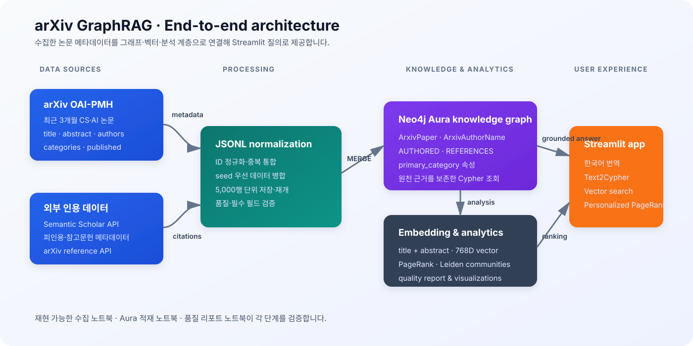

```text
arXiv OAI-PMH ──┐
                 ├─> JSONL 정규화 ──> Neo4j Aura 지식 그래프
Semantic Scholar ┘                         │
                                           ├─> 768D 임베딩·벡터 인덱스
                                           ├─> Text2Cypher 관계 질의
                                           └─> Streamlit GraphRAG 앱
```

처리 흐름은 `논문 수집 → 인용·참고문헌 수집 → 메타데이터 결합 → Aura 적재 → 임베딩·검색 → 품질 검증` 순서입니다.

## Quick start

### Requirements

- Python 3.12+
- `uv`
- Neo4j Aura 접속 정보
- OpenAI API 키

### Run

`.env.example`을 `.env`로 복사한 뒤 Neo4j Aura와 OpenAI 접속 정보를 채웁니다. 앱은 실행 시 Aura와 벡터 인덱스에 연결합니다. 개발 테스트는 DB/API 연결 없이 실행할 수 있습니다. 노트북 의존성은 `uv sync --locked --extra notebooks --extra gds`로 설치합니다. Aura Graph Analytics를 사용하지 않는다면 기본 앱 설치만으로 충분합니다.

```bash
uv sync --locked --group dev
uv run streamlit run app.py
```

앱은 `홈`, `챗봇`, `PageRank 순위`, `품질 게이트` 네 탭을 제공합니다. 앱의 상세 설정과 오류 대응은 [`APP_README.md`](APP_README.md)에 정리했습니다.

배포된 앱은 [Streamlit 데모 주소](https://arxivgraphrag-nxuoq53irzeuzpqgdtkeun.streamlit.app/)에서 바로 확인할 수 있습니다.

Streamlit Community Cloud 앱은 한동안 사용하지 않으면 잠들 수 있습니다. `Zzzz` 안내가 보이면 **Yes, get this app back up!**을 누르고 시작될 때까지 기다리세요. 2026-09-27 확인 시 앱이 깨어난 뒤 Aura에 연결되어 홈 화면과 그래프 지표를 표시했습니다.

## Data

`old` 폴더는 제외하고 현재 프로젝트의 JSONL과 노트북을 기준으로 설명합니다.

| 데이터 | 경로 | 내용 |
| --- | --- | --- |
| AI 논문 | `data/ai/arxiv_cs_recent_3months_oai_part1~2.jsonl` | 최근 3개월 AI 논문 **6,467건**. 제목, abstract, 저자, 분류, 발행일, DOI, PDF URL 포함 |
| 인용 원천 | `data/citations_ai/arxiv_citations_part1~2.jsonl` | AI 논문별 Semantic Scholar 인용·참고문헌 메타데이터 |
| 참고문헌 논문 | `data/ai_references/arxiv_ai_references_api/arxiv_ai_references_api_part1~7.jsonl` | AI 논문이 인용한 논문 메타데이터 **31,913행** 및 `cit_arxiv_id` 목록 |

동일한 arXiv ID는 하나의 논문으로 통합합니다. 적재 결과는 논문 **37,854개**, 저자 이름 **111,171개**, `AUTHORED` **268,928개**, `REFERENCES` **69,438개**입니다.

### 실행 노트북 파일

- [`arxiv_computer_science_recent_3months_to_jsonl_oai_pmh.ipynb`](notebooks/arxiv_computer_science_recent_3months_to_jsonl_oai_pmh.ipynb) — arXiv OAI-PMH에서 CS 메타데이터를 수집하고 `published`, `primary_category`로 필터링
- [`arxiv_citations_semantic_scholar_to_jsonl.ipynb`](notebooks/arxiv_citations_semantic_scholar_to_jsonl.ipynb) — Semantic Scholar Graph API를 배치 조회해 피인용·참고문헌 목록과 인용 지표를 `data/citations_ai`에 저장
- [`arxiv_citation_references_arxiv_api_to_jsonl.ipynb`](notebooks/arxiv_citation_references_arxiv_api_to_jsonl.ipynb) — 참고문헌 arXiv ID의 메타데이터를 5,000행 단위 JSONL로 수집하고 캐시·상태 파일으로 재개
- [`arxiv_ai_kg_to_aura.ipynb`](notebooks/arxiv_ai_kg_to_aura.ipynb) — JSONL 정규화, Aura 적재, 제목+abstract 임베딩, 벡터 인덱스 생성

## Ontology

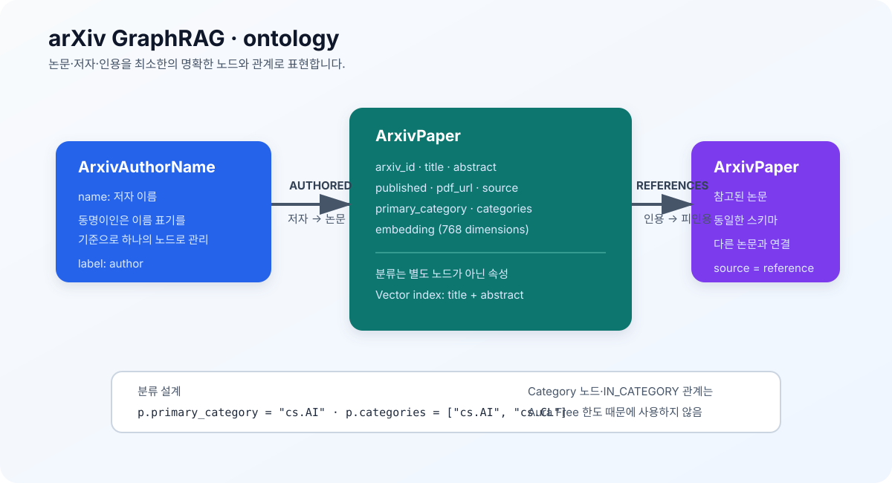

```text
(:ArxivAuthorName {name})-[:AUTHORED]->(:ArxivPaper)
(:ArxivPaper)-[:REFERENCES]->(:ArxivPaper)
```

| 요소 | 설계 |
| --- | --- |
| `ArxivPaper` | `arxiv_id`, `title`, `abstract`, `published`, `pdf_url`, `primary_category`, `categories`, `source`, `embedding` |
| `ArxivAuthorName` | 저자 이름 `name`을 식별하는 노드 |
| `AUTHORED` | 저자에서 논문으로 향하는 저술 관계 |
| `REFERENCES` | 인용 논문에서 피인용 논문으로 향하는 관계 |
| 분류 | `primary_category`, `categories` 속성으로 저장 |

Aura Free의 관계 한도와 고차수 허브 문제를 고려해 `Category` 라벨과 `IN_CATEGORY` 관계는 만들지 않았습니다. `arxiv_id`는 URL·`arXiv:` 접두어·버전 접미어를 제거해 정규화하며, 임베딩 입력은 `title + abstract`입니다.

## Knowledge graph

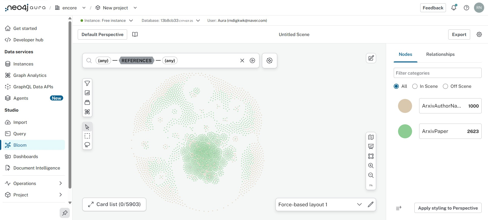

## Quality report

품질 리포트 노트북은 그래프와 원천 JSONL을 대조해 준수율·정밀도·ER 일관성을 검사하고, GDS로 PageRank와 Leiden 커뮤니티를 분석합니다.

- 분석 노트북: [`aura_graph_rag_quality_report.ipynb`](notebooks/aura_graph_rag_quality_report.ipynb)
- 결과 JSON: [`aura_graph_rag_quality_report.json`](reports/aura_graph_rag_quality_report.json)

| 지표 | 결과 |
| --- | --- |
| 스키마 준수율 | 노드·`AUTHORED`·`REFERENCES` 모두 **100%** |
| 정밀도 | 고정 시드 42, 표본 50건의 6개 사실 모두 **100%** |
| ER 일관성 | 중복 ID·필수값 누락·고아 논문·타입 오류·자기참조 **0건** |

## Community analysis

품질 리포트 노트북은 `REFERENCES` 인용망을 기반으로 Leiden 커뮤니티 탐지를 수행합니다. AuraDB Free에는 GDS가 내장되어 있지 않으므로 임시 Aura Graph Analytics 세션에서 계산하며, 원본 AuraDB에는 분석 결과를 쓰지 않습니다. 세션 설정은 2GB 메모리, TTL 30분입니다.

Leiden 분석에서는 방향성이 있는 `REFERENCES` 관계를 커뮤니티 탐지에 사용할 수 있도록 무방향 투영으로 바꿉니다. 따라서 같은 커뮤니티로 묶였다는 것은 두 논문이 같은 분류라는 뜻이 아니라, 인용망에서 서로 연결된 구조적 군집에 속한다는 의미입니다. `randomSeed=42`와 고정 레이아웃을 사용해 결과와 시각화를 재현할 수 있으며, 커뮤니티 번호 자체에는 의미가 없습니다.

리포트는 규모가 큰 상위 5개 커뮤니티의 논문 수와 최빈 `primary_category` 조합을 집계합니다.

| 커뮤니티 | 논문 수 | 대표 분류 조합 |
| --- | ---: | --- |
| C1 | 3,874 | `cs.AI` · `cs.CL` |
| C2 | 2,725 | `cs.CL` · `cs.LG` |
| C3 | 2,513 | `cs.CV` · `cs.CL` |
| C4 | 2,375 | `cs.CL` · `cs.AI` |
| C5 | 1,827 | `cs.CV` · `cs.RO` |

### 커뮤니티 크기 분포

커뮤니티별 논문 수를 큰 순서로 비교해 특정 군집에 논문이 얼마나 집중되는지 보여 줍니다. 막대의 분류 라벨은 해당 커뮤니티에서 가장 많이 나타난 주분류를 나타냅니다.

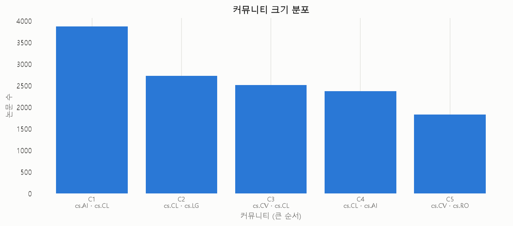

### 커뮤니티 메타그래프

각 점은 하나의 커뮤니티이며 점의 크기와 점 안 숫자는 커뮤니티의 논문 수를 뜻합니다. 선의 굵기는 두 커뮤니티 사이의 상호 `REFERENCES` 인용 흐름을 나타내므로, 인용 교류가 많은 군집과 군집 간 연결을 한눈에 확인할 수 있습니다.

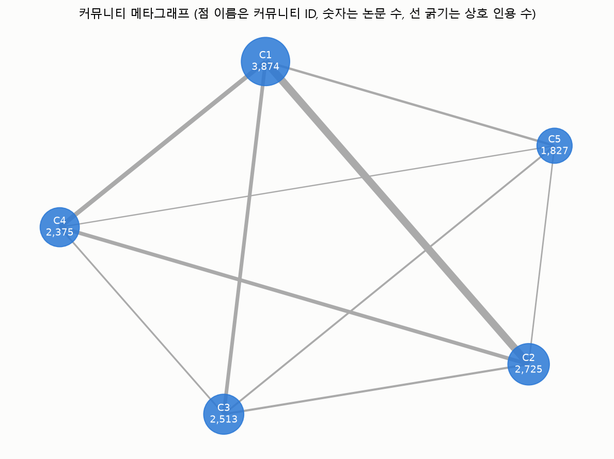

## Streamlit demo

### Home — 그래프 현황과 스키마

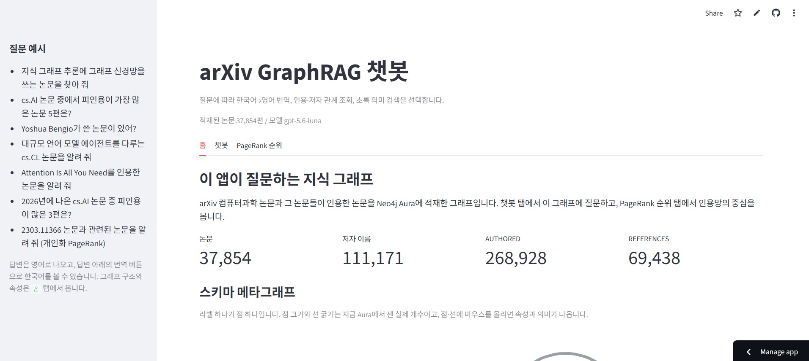

적재된 논문·저자·관계 수와 스키마 메타그래프를 한 화면에서 확인합니다.

### Chatbot — 의미 기반 벡터 유사도 논문 검색

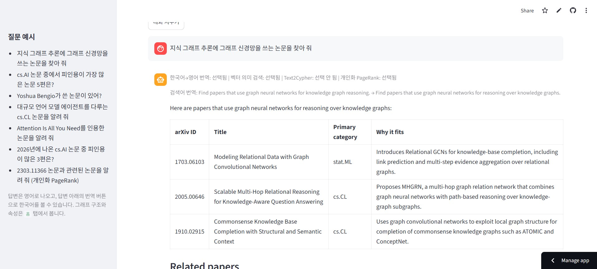

한국어 질문을 영어로 변환하고 제목·초록의 벡터 유사도로 관련 논문을 추천합니다.

### Chatbot — 개인화 PageRank 관련 논문

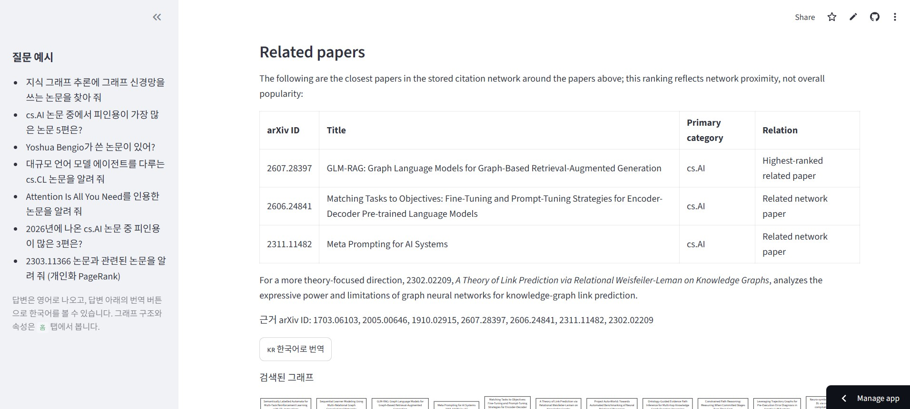

질문 또는 검색 결과 논문을 시드로 삼아 인용 네트워크에서 가까운 논문을 찾습니다.
추천 표에는 시드와 추천 논문 사이의 최단 인용 경로도 표시됩니다. 추천 논문을 세션 목록에
저장한 뒤 초록이 있는 2~4편을 골라 비교할 수 있으며, 화면 구성과 보존 범위는
[`APP_README.md`](APP_README.md)에서 설명합니다.

### Chatbot — 답변 번역

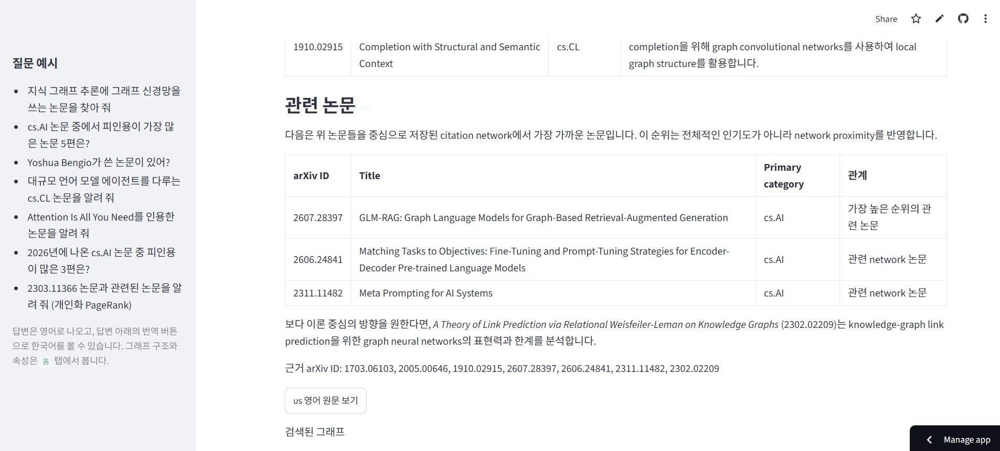

영어 답변을 한국어로 전환하고 다시 영어 원문으로 돌아갈 수 있습니다.

### Chatbot — PageRank 근거

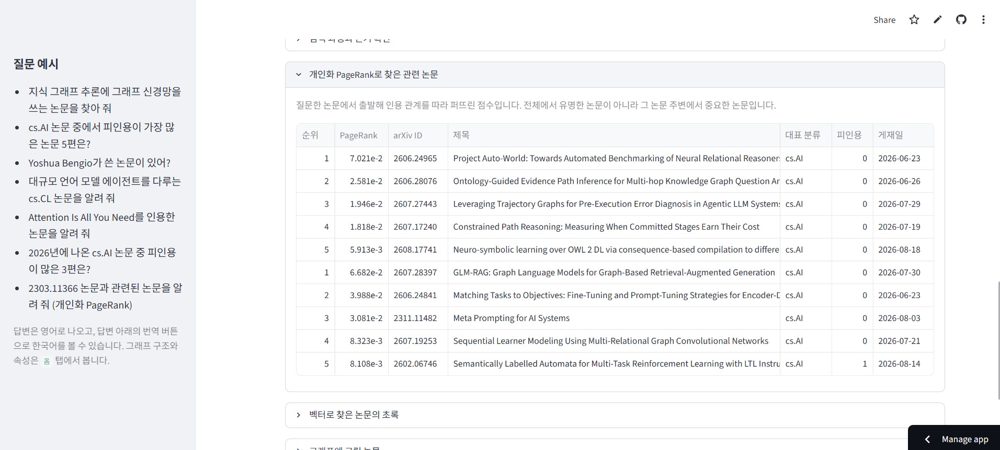

시드 논문 주변의 PageRank 점수와 논문 정보를 표로 확인합니다.

### Chatbot — Text2Cypher

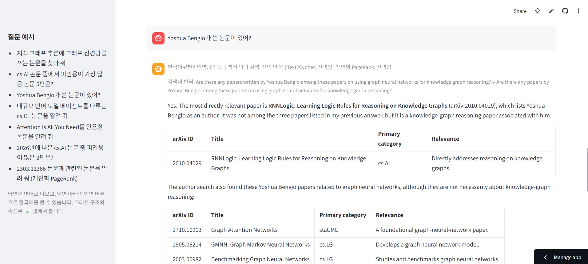

저자·논문·인용 관계를 조회 전용 Cypher로 탐색합니다.

### PageRank — 계산 조건

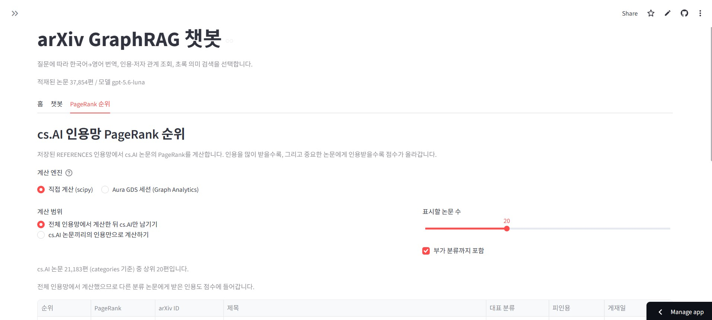

직접 계산 또는 Aura GDS를 선택하고 인용망 범위·표시 개수·부가 분류 포함 여부를 설정합니다.

### PageRank — 순위와 인용 관계

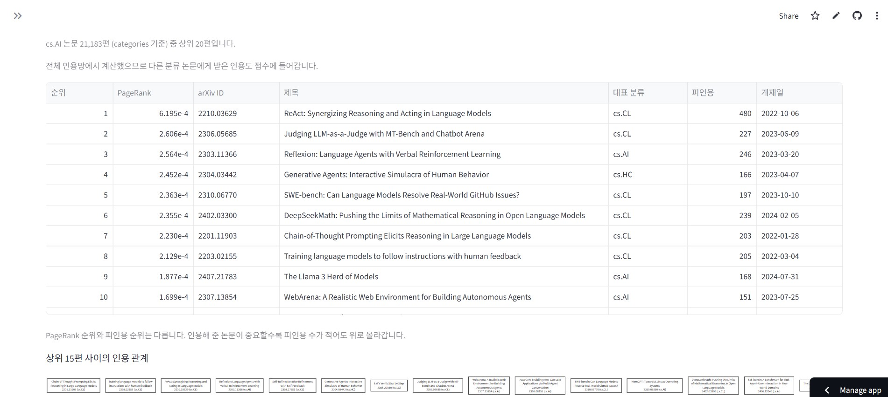

PageRank 점수·논문 정보·피인용 수를 순위표로 보고 상위 논문 간 인용 관계를 확인합니다.

### PageRank — 엔진 비교

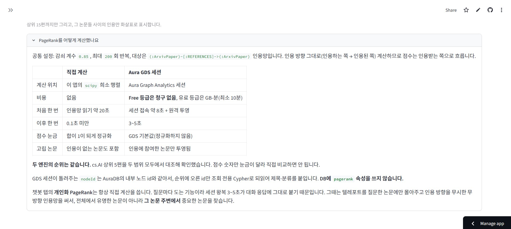

직접 계산과 Aura GDS 세션의 계산 위치·비용·속도·점수 눈금·고립 논문 처리 차이를 설명합니다.

### 품질 게이트 — 측정을 한 화면에

이 저장소의 측정이 보고서 90여 개와 결정 기록에 흩어져 있어서, 처음 보는 사람이 2분 안에
확인할 방법이 없었습니다. 네 번째 탭이 그것을 모읍니다.

| 블록 | 내용 |
|---|---|
| 규칙 | 게이트 일곱 규칙과 각각이 막는 것 |
| 지표 | 측정값 · 절대 하한 · 허용 하락폭 · **여유** · 3회 변동폭 |
| 하한의 근거 | 기준선의 `floor_rationale`을 문장 그대로 |
| RAGAS 하한 검사 | 12회 실행 중 최악값, 그리고 **결함을 심으면 걸리는가** |
| 프롬프트 지문 | 기준선이 잰 본문과 **지금 코드의 본문**을 나란히 |
| 하네스 밖의 선 | 관련 논문 슬롯과 모델 승격 — 게이트가 보지 않는 둘 |
| 변형 비교 | 미래 라벨 과제의 여섯 변형, 연결 정도로 나눈 표 |
| 기각한 모델 | 여섯 개와 각각 어디서 졌는지 |

**새로 재지 않습니다.** 기준선 파일과 커밋된 보고서를 읽어 모양만 바꿉니다 — 화면이 숫자를
만들면 그 숫자의 출처가 화면 코드가 되고 되짚을 수 없습니다. 화면과 읽기를 나눠 둬
([`quality_board.py`](quality_board.py)는 Streamlit을 가져오지 않습니다) **접속 없이
테스트**합니다.

**여유가 변동폭보다 좁은 하한을 세어 보여 줍니다.** 그런 하한은 품질이 아니라 운을 재기
때문입니다([ADR-004](docs/adr/ADR-004-quality-gate-thresholds.md)). 현재 0건입니다.

## Project structure

```text
.
├── app.py                         # Streamlit 진입점 (네 탭)
├── chatbot.py                     # 검색 도구 5개·에이전트·개인화 PageRank
├── routing.py                     # 질문 유형으로 경로를 정하는 규칙
├── abstain.py                     # 답하지 못한 이유를 사유 코드로 설명
├── forecast.py                    # 승격된 가중치를 읽어 "함께 인용될 논문" 재정렬
├── citations.py                   # 저장 목록 → BibTeX·CSV (Streamlit 미사용)
├── quality_board.py               # 게이트·하한·기각 기록을 화면용으로 (Streamlit 미사용)
├── paper_library.py               # 세션 논문 저장·비교 선택 처리
├── gds_pagerank.py                # Aura Graph Analytics PageRank
├── metagraph.py                  # 스키마·커뮤니티 시각화
├── APP_README.md                 # 앱 상세 문서
├── data/                         # JSONL 및 데모 이미지
├── notebooks/                    # 수집·적재·품질 분석 노트북
├── reports/                      # 그래프 품질·검색 평가 결과
├── evals/                        # 검색·답변 평가 데이터와 실행기
├── EXPERIMENTS.md                # 실험 기록 (질문·방법·결과·결론)
├── docs/adr/                     # 결정 기록 — 무엇을 쓰고 무엇을 왜 안 쓰는지
├── pipeline/                     # 스냅샷 고정·품질 게이트·증분 수집·실험 추적
├── models/link_prediction/       # 공동인용 링크 예측 데이터셋·기준선
├── snapshots/                    # 스냅샷 매니페스트 (sha256·기준월·게이트 결과)
└── tests/                        # 평가 지표·실행기·파이프라인 단위 테스트
```

## Limitations and retrospective

- Neo4j Aura Free의 노드·관계 한도 때문에 `Category` 라벨과 `IN_CATEGORY` 관계를 만들지 못하고 분류를 논문 속성으로 저장했습니다.
- 시간 제약으로 AI 외 다른 분야의 논문까지 수집하지 못했습니다.
- AI 관련 논문이 인용한 1-hop 논문만 수집해 더 깊은 인용망은 포함하지 못했습니다.
- 컴퓨터 용량 제약으로 PDF를 청킹·임베딩하지 못하고 제목과 abstract만 사용했습니다.
- 예측 패널의 **정답이 아직 오지 않았습니다.** 모델이 통과한 기준은 과거 창에서 잰 것이고,
  실제 채점에는 다음 달 스냅샷이 필요합니다([ADR-038](docs/adr/ADR-038-the-forecast-panel.md)).
- 그 다음 달을 넣을 자리는 **세어 두었습니다** — 관계가 먼저 차고, 적재가 멈추는 선(95%)
  안에서 **3.4개월**(가장 생산량이 많았던 달의 속도로는 2.0개월)이 남아 있어 **아무것도
  지우지 않고** 들어갑니다. 지울 후보는 수확과 함께 **무엇을 깨뜨리는지**까지 쟀고, 네 번째
  달이 필요해지면 먼저 재야 하는 것도 적었습니다
  ([ADR-045](docs/adr/ADR-045-what-to-delete-before-adding-a-month.md)).
- 다만 **자리가 있다고 바로 넣을 수는 없습니다.** 증분 적재문이 `embedding`을 쓰지 않아서,
  그대로 넣으면 새 논문이 그래프 질의에는 나오고 **벡터 검색에는 안 나옵니다.** 스냅샷
  게이트가 커버리지 100%를 요구하지만 그것은 적재 뒤에 걸리므로, 같은 검사를 적재 전에
  한 번 더 두어 막았습니다
  ([ADR-047](docs/adr/ADR-047-the-loader-refuses-papers-the-vector-index-cannot-see.md)).
- 관련 논문 패널의 임베딩 보충은 근거가 **대리 지표**입니다. hit@5 <!--n:reports/related_future_study.json#by_degree_slice.no_citation_edges.cocited.hit_at_k-->0.4739<!--/n-->는 "상위 다섯 중
  하나가 나중에 **함께 인용된다**"이고 "읽을 만하다"가 아닙니다. 클릭·저장 같은 사용자 신호를
  모으면 다시 잴 수 있지만 그 장치는 없습니다.

## Data pipeline and models

데이터는 버전이 박힌 스냅샷으로 고정하고, 학습과 평가는 살아 있는 DB가 아니라 그 스냅샷만
읽습니다. 인용 보강이 과거 논문 쌍에도 간선을 역채움하므로, 라이브 DB에 학습하면 시간 분할이
조용히 무너집니다([`ROADMAP.md` 9절](ROADMAP.md#9-개선안-ab를-동시에-적용할-때의-충돌)).

```bash
# 내보내기를 버전 스냅샷으로 등록하고 품질 게이트 10개를 돌립니다
uv run python -m pipeline.build_snapshot

# 파생 캐시(메타데이터·임베딩 행렬)를 만듭니다
uv run python -m pipeline.features

# Aura에 남은 자리와 지울 후보 — 수확과 "깨뜨리는 것"을 함께 셉니다 (DB에 붙지 않습니다)
uv run python -m pipeline.capacity

# 증분 수집 시험 실행 — --load 없이는 Aura에 쓰지 않습니다
uv run python -m pipeline.ingest --days 7

# 공동인용 링크 예측 기준선 사다리
uv run --extra ml python -m models.link_prediction.train

# 피처 절제 + cold-start (스냅샷만 읽으므로 API 비용 없음)
uv run --extra ml python -m models.link_prediction.ablation

# 인용 쌍으로 임베딩 어댑터 학습 (닫힌 해, GPU 불필요)
uv run python -m models.embedding_tuning.train

# 로컬 임베딩 모델과 비교. 첫 실행은 CPU 인코딩에 모델당 3시간 25분 걸립니다
uv run --with sentence-transformers python -m models.embedding_tuning.compare_models   --model sentence-transformers/allenai-specter

# Colab T4에서 파인튜닝하려면 17.6MB 산출물을 내보냅니다 (GPU가 없는 PC에서)
uv run python -m models.embedding_tuning.export_for_colab
```

내보낸 산출물은 Hugging Face 비공개 dataset repo로 올립니다. `huggingface_hub` 2.x의 실행 파일
이름은 `hf`입니다(`huggingface-cli`는 없습니다).

```bash
uv tool install huggingface_hub
hf auth login
hf upload <사용자>/arxiv-graphrag-colab exports/colab exports/colab --repo-type dataset --private
```

파인튜닝 노트북은 [`notebooks/finetune_embedding_colab.ipynb`](notebooks/finetune_embedding_colab.ipynb)
입니다. `SMOKE = True`로 먼저 돌려 코드가 도는지 확인하고 본 실행을 하세요.

## Experiments

왜 그렇게 설계했고 무엇을 기각했는지는 [`EXPERIMENTS.md`](EXPERIMENTS.md)에 실험 단위로
적었습니다 — 질문 / 방법 / 결과 / 결론 순서이며, 틀렸던 가설과 과했던 수정도 함께 남겼습니다.

## Decisions (ADR)

실험 기록은 "어떻게 알았는가"에 답하지만 "그래서 지금 무엇을 쓰는가"에는 답하지 않습니다.
그 질문의 답은 [`docs/adr/`](docs/adr/README.md)에 번호를 붙여 두었습니다 — 채택·기각·보류와
각 결정의 근거 수치, 그리고 **어떤 가정이 바뀌면 그 결정이 바뀌는지**(민감도)까지 적습니다.

## Advanced evaluation

RAG 검색·답변 평가 방법과 이번 개선 변경점은 [`advanced.md`](advanced.md)에 정리했습니다.

```bash
# 그래프 조건 평가 케이스를 만들고 정답을 라이브 DB의 Cypher와 대조합니다
uv run python -m evals.build_graph_cases --verify-against-db

# 벡터 단독 대 GraphRAG 비교
uv run python -m evals.run --mode compare --cases evals/cases_graph.json --limit 30   --output reports/rag_eval_graph_compare.json

# 조건 판정 심판만 따로 재는 하네스
uv run python -m evals.judge_study

# GraphRAG 변형 비교 (벡터 / PPR / 하이브리드), 질문 유형별
uv run python -m evals.variant_study

# LLM 색인 비용 하한과 부분 색인 정답 커버리지
uv run --group dev python -m evals.index_cost

# 한국어 질문의 번역 손실 (혼용/순수 두 형태 × 직접/번역)
uv run python -m evals.language_study

# 다른 곳에서 돌린 실행의 보고서를 로컬 추적에 등록 (예: Colab 파인튜닝)
uv run python -m pipeline.register_run reports/embedding_finetune_colab.json

# 집계 순위 질문이 수치를 문자열로 정렬하는 빈도 (유형당 반복 실행)
uv run python -m evals.order_study --repeats 3

# RAGAS 하한이 최악의 정상 실행을 넘는지, 결함을 심으면 걸리는지 (API 비용 없음)
uv run python -m evals.ragas_spread --floors baselines/eval_baseline.json \
    --group "기준선=reports/baseline_resolve_run1_ragas.json,reports/baseline_resolve_run2_ragas.json,reports/baseline_resolve_run3_ragas.json" \
    --perturbed reports/ragas_perturbed_luna.json

# 평가를 돌리지 못했다는 표식이 있으면 그 사유를 적습니다 (CI 요약이 이것을 읽습니다)
uv run python -m evals.budget --explain

# 모델이 쓴 Cypher를 막는 가드를 40가지로 때립니다 (EXPLAIN만, 통과한 질의도 실행 안 함)
uv run python scripts/probe_cypher_guard.py --list   # 질의만, 접속 없음
uv run python scripts/probe_cypher_guard.py

# 교차 인코더에 보낼 (시드, 후보) 쌍 68,182개를 굳혀 내보냅니다 (GPU는 밖에서)
uv run python -m evals.export_rerank_pairs

# 밖에서 채점한 쌍 점수로 재정렬 변형을 판정합니다
uv run python -m evals.related_study --cases evals/cases_related_future.json     --variants rerank vector --rerank-scores derived/2026-10-14/rerank-<slug>.jsonl.gz     --output reports/rerank_<name>.json
```

> **API 비용이 없는 하네스와 있는 하네스가 갈립니다.** 임베딩 비교(`related_study`·
> `embedding_slice_study`), 하한 검사(`ragas_spread --floors`), 용량 계산(`pipeline.capacity`),
> 재채점(`rescore`)은 **스냅샷과 커밋된 보고서만 읽습니다** — OpenAI도 Aura도 쓰지 않습니다.
> 답변을 새로 만드는 `run`·`ragas_study`·`judge_study` 계열만 호출이 듭니다.

## Verification

GitHub Actions에서 잠금 파일, Ruff, 단위 테스트, Python 구문을 확인합니다. README의 링크와 이미지 경로는 현재 저장소의 노트북·리포트·이미지를 기준으로 작성했습니다. 품질 수치는 [`reports/aura_graph_rag_quality_report.json`](reports/aura_graph_rag_quality_report.json)의 생성 결과를 따릅니다.
