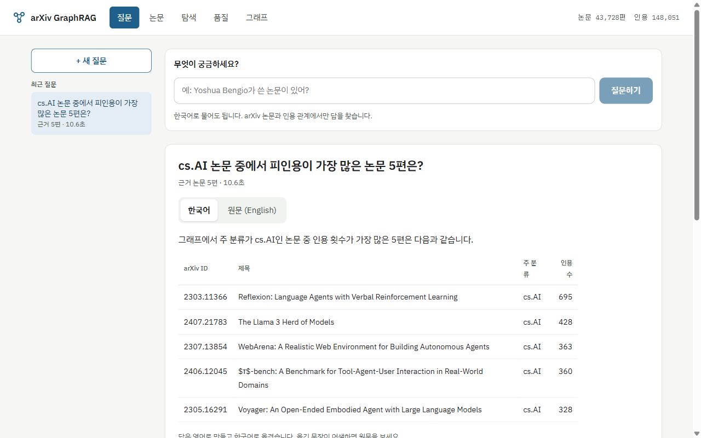
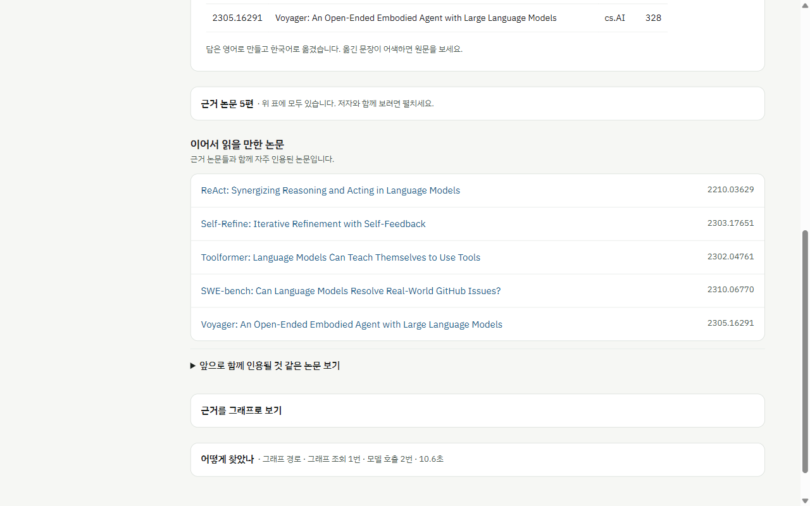
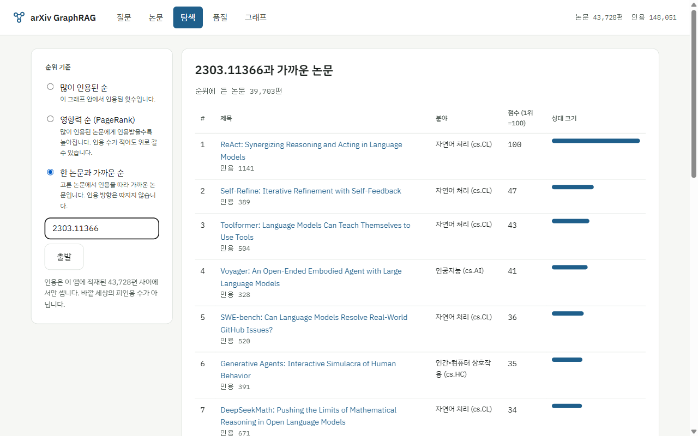
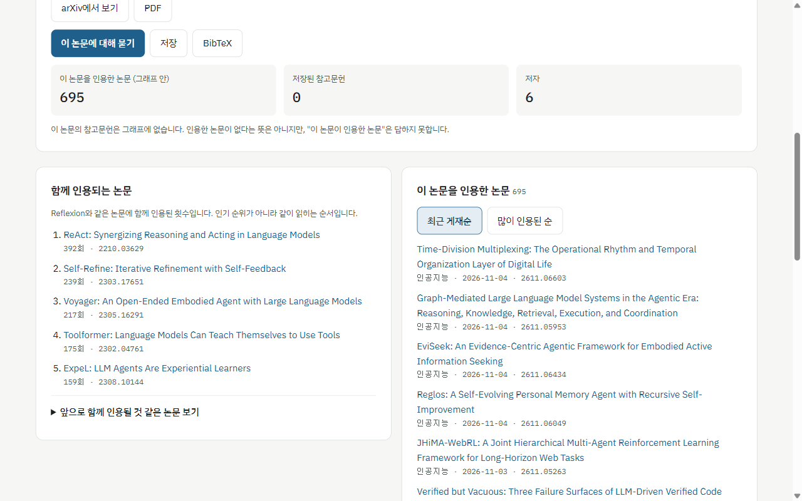
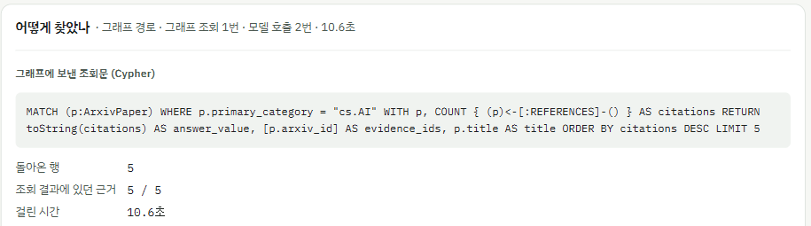
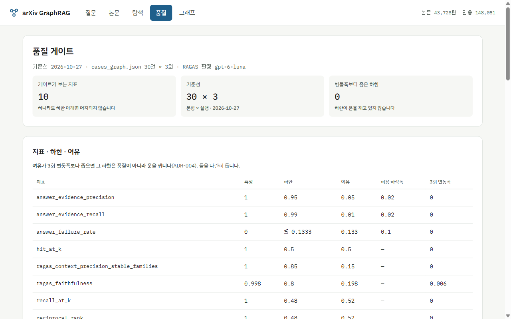
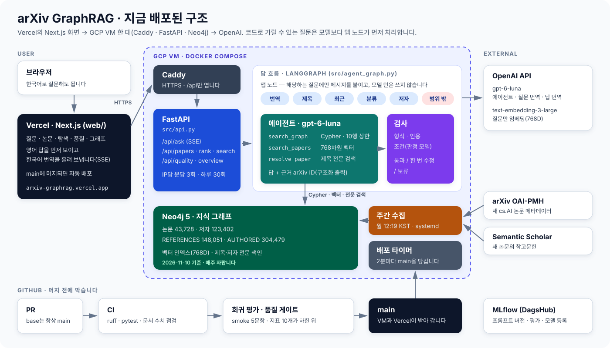

# arXiv GraphRAG

arXiv AI 논문 4만여 편과 인용 관계를 Neo4j 지식 그래프로 만들고, 한국어 질문에 **그래프에 있는 논문만 근거로** 답하는 GraphRAG 앱입니다.

[](https://www.python.org/)
[](https://neo4j.com/)
[](https://nextjs.org/)
[](https://fastapi.tiangolo.com/)

🌐 **Live demo:** [arXiv GraphRAG](https://arxiv-graphrag.vercel.app/) (Next.js, API는 GCP VM) · [Streamlit 백업 판](https://arxivgraphrag-nxuoq53irzeuzpqgdtkeun.streamlit.app/) (2026-10-27 그래프로 고정)

## 데모

| | |
|---|---|
|  |  |
| **질문** — 한국어로 묻고, 근거 arXiv ID가 붙은 답을 받습니다 | **근거와 다음 읽을거리** — 함께 자주 인용된 논문을 그래프에서 찾아 붙입니다 |
|  |  |
| **탐색** — 한 논문에서 인용을 따라 가까운 논문(개인화 PageRank) | **논문** — 함께 인용되는 논문, 이 논문을 인용한 논문 695편 |



**어떻게 찾았나** — 모델이 쓴 Cypher, 돌아온 행, 답의 근거가 조회 결과에 있었는지(5/5)를 답마다 보여 줍니다.
측정은 [품질 화면](https://arxiv-graphrag.vercel.app/quality)에 모여 있습니다.

<details>
<summary>품질 화면</summary>



</details>

## 30초 요약

- **무엇을 하나** — "Yoshua Bengio가 쓴 논문이 있어?", "Attention Is All You Need를 인용한 논문을 알려 줘" 같은 질문에
  그래프를 조회해 답하고, 답의 모든 논문을 arXiv ID로 근거를 답니다. 근거가 조회 결과에 없으면 답하지 않고 보류합니다.
- **어떻게** — 에이전트(`gpt-6-luna`)가 도구 셋을 씁니다: Cypher 조회(`search_graph`), 제목·초록 768차원 벡터 검색(`search_papers`),
  제목 전문 검색(`resolve_paper`). 그 앞에서 **앱 노드**가 번역·제목·"최근"·분류·저자 이름·범위 밖 질문을 코드로 먼저 처리해
  모델 턴을 아낍니다.
- **무엇을 판별했나** — 관련 논문 추천에서 학습 모델 셋을 재서 기각하고 Cypher 한 줄을 골랐습니다(recall@5 2.2배).
  직접 학습한 공동인용 예측 GBM은 휴리스틱을 신뢰구간으로 이겨 채택했고, 임베딩 파인튜닝 세 번은 OpenAI 임베딩을 넘지 못해 기각했습니다.
  결정 126개를 [ADR](docs/adr/README.md)로 남기고, 뒤집힌 결정도 지우지 않습니다. 한 장 요약은 [`docs/VALIDATION.md`](docs/VALIDATION.md)입니다.
- **어떻게 지키나** — PR마다 회귀 평가가 돌고, 지표 10개 중 하나라도 하한 아래면 머지되지 않습니다.
  모델이 쓴 Cypher는 읽기 전용 세션 · 계획 유형 검사 · 프로시저 허용 목록의 세 겹으로 막습니다.
- **어디서 도나** — 화면은 Vercel의 Next.js, API·Neo4j는 GCP VM 한 대. 그래프는 매주 월요일 새 논문을 받아 자랍니다.

## 핵심 지표

| 무엇 | 값 | 출처 |
|---|---|---|
| 관련 논문 recall@5 — Cypher 공동인용 정렬 대 개인화 PageRank | **0.8892** 대 0.3957 (적격 시드 3,740개 전수) | [ADR-030](docs/adr/ADR-030-related-papers-needs-a-query-not-a-model.md)·[034](docs/adr/ADR-034-measure-every-eligible-seed.md) |
| 직접 학습한 모델 — 공동인용 예측 `graph-text-gbm` | MRR **0.6513**, 최고 휴리스틱 대비 +0.0818 [+0.0699, +0.0936] | [ADR-031](docs/adr/ADR-031-the-model-that-wins-is-the-forecast.md) |
| 재서 기각한 모델 | 선형 어댑터 · 미세조정 임베딩 · 교차 인코더 재정렬 등 아홉 | [`docs/VALIDATION.md`](docs/VALIDATION.md) · [`docs/MODELS.md`](docs/MODELS.md) |
| 머지 게이트 | 지표 10개 · 규칙 7개, 변동폭보다 좁은 하한 0개 | [`docs/EVALUATION.md`](docs/EVALUATION.md) 4절 |
| 답 지연 (VM 서버) | 영어 15문항 p50 **6.09초**, 한국어 화면 예시 7문항 중 6개가 10초 안 | [`docs/EVALUATION.md`](docs/EVALUATION.md#지연은-품질과-따로-잽니다) |
| Cypher 가드 공격 | 40가지 중 쓰기 20/20 차단, 외부 읽기 2건을 찾아 막음 | [ADR-048](docs/adr/ADR-048-the-type-check-does-not-know-the-internet.md) |
| 그래프 (2026-11-10) | 논문 43,728 · 저자 123,402 · 인용 148,051 · 저술 304,479 | [`docs/DATA.md`](docs/DATA.md) |
| 기록 | ADR 126개 · 실험 70여 건 · 테스트 1,600여 개 | [ADR 색인](docs/adr/README.md) · [`EXPERIMENTS.md`](EXPERIMENTS.md) |

## Architecture



- **화면** — Vercel의 Next.js(`web/`). 질문 · 논문 · 탐색 · 품질 · 그래프 다섯 화면이고, 답은 영어로 먼저 보이고 한국어 번역을 흘려 보냅니다(SSE).
- **API** — GCP VM의 FastAPI(`src/api.py`) 앞에 Caddy가 HTTPS를 받습니다. VM 한 대에 Neo4j·API·Caddy가 컨테이너로 돕니다
  ([`deploy/vm/compose.yml`](deploy/vm/compose.yml), [ADR-079](docs/adr/ADR-079-one-vm-mounts-the-repo-and-opens-only-https.md)).
  IP당 분당 3회 · 하루 30회로 유료 호출을 막습니다.
- **답 흐름** — LangGraph로 [`src/agent_graph.py`](src/agent_graph.py)에 있습니다.
  1. 앱 노드: 번역([ADR-087](docs/adr/ADR-087-translate-before-the-agent.md)) → 제목 해석([088](docs/adr/ADR-088-resolve-the-named-paper-before-the-agent.md)) → "최근" 기간([090](docs/adr/ADR-090-recent-is-a-date-filtered-search.md)) → 분류([113](docs/adr/ADR-113-search-the-named-category-before-the-agent.md)) → 저자 후보([121](docs/adr/ADR-121-an-inexact-author-name-gets-the-candidates-first.md)) → 범위 밖 거절([095](docs/adr/ADR-095-out-of-scope-at-the-router.md)).
     해당하는 질문에만 메시지를 붙이고 지시문·도구는 그대로라, 다른 질문의 턴이 느려지지 않습니다.
  2. 에이전트가 도구로 그래프를 조회합니다. 긴 논문 목록은 도구에서 10행으로 자르고([ADR-120](docs/adr/ADR-120-long-paper-lists-are-cut-to-ten-rows-at-the-tool.md)), 모양만 어긋난 근거 별칭은 고쳐 받습니다([ADR-122](docs/adr/ADR-122-repair-an-id-shaped-evidence-alias-at-the-tool.md)).
  3. 형식·인용 검사와 조건 판정을 통과해야 답합니다. 실패하면 한 번 고치고, 그래도 안 되면 이유와 함께 보류합니다.
- **수집** — 매주 월요일 VM이 arXiv OAI-PMH에서 새 논문을, Semantic Scholar에서 그 참고문헌을 받습니다
  ([ADR-099](docs/adr/ADR-099-keep-the-weekly-ingest-criteria.md)·[104](docs/adr/ADR-104-weekly-ingest-runs-on-the-vm.md)). 멈추면 health와 이슈가 알립니다([ADR-106](docs/adr/ADR-106-alert-when-the-vm-ingest-stops.md)).
- **배포** — main에 머지되면 VM 타이머가 2분 안에 받아 다시 띄우고, Vercel도 다시 빌드합니다.

## 판별한 것

**"GraphRAG 앱을 만들었다"가 아니라 "변화가 도움이 되는지 판별했다"가 이 저장소의 주장입니다.**
학습한 모델과 판정, 걸린 함정, 평가 도구 검증을 한 장에 모은 것이 [`docs/VALIDATION.md`](docs/VALIDATION.md)이고,
자세한 경과는 [`docs/ENGINEERING.md`](docs/ENGINEERING.md)에 있습니다.

1. **학습 모델을 재서 기각하고 Cypher 한 줄을 골랐습니다.** 관련 논문 자리에서 선형 어댑터 둘·벡터 최근접·개인화 PageRank가
   공동 인용자 수로 정렬하는 Cypher에 졌습니다(0.8892 대 0.3957 이하). 정답이 공동인용이라 이 정답으로는 모델을 재지 못한다는 점도 적었습니다.
2. **지표가 품질이 아니라 정렬 순서를 재고 있었습니다.** `reciprocal_rank` 1.0은 "목록이 전부 정답이고 알파벳순"이라는 뜻이었습니다.
   순서에 의존하지 않는 집합 지표를 더했습니다([ADR-033](docs/adr/ADR-033-rank-metrics-measure-the-alphabet.md)).
3. **토큰 수는 비용이 아니었습니다.** 입력의 86~87%가 프리픽스 캐시 할인이라, "입력 29% 절감"을 고쳐 적고
   컨텍스트 압축도 기각했습니다([ADR-025](docs/adr/ADR-025-reject-context-compression.md)).
4. **집계 1위 모델을 집단으로 쪼개 기각했고, 그 판단이 나중에 확인됐습니다.** `graph-text-gbm`은 두 집단 모두에서 졌고,
   배포 경로의 빈칸을 메우자 집계 우위도 사라졌습니다([ADR-037](docs/adr/ADR-037-the-gbm-wins-the-average-and-loses-both-halves.md)·[040](docs/adr/ADR-040-fill-the-empty-panel.md)).

5. **평가 도구 자체를 시험했습니다.** 결함을 심은 답 20건에서 지표가 1.000 → 0.000으로 떨어지는지 봤고,
   일부러 망친 모델이 승격 판정에서 거부되고 롤백되는 것까지 돌렸습니다([ADR-032](docs/adr/ADR-032-close-the-model-lifecycle.md)).

1~4 중 둘은 제가 먼저 틀리게 적고 측정으로 고친 것이고, 그 과정이 ADR에 남아 있습니다.

## 처음 보시는 분께 — 더 읽을 곳

| 보고 싶은 것 | 어디로 |
|---|---|
| **무엇을 재서 무엇을 버렸나 (한 장 요약)** | [`docs/VALIDATION.md`](docs/VALIDATION.md) — 학습한 모델과 결과, 걸린 함정, 평가 도구 검증, 머지를 막는 장치 |
| **지금 무엇을 쓰고, 무엇을 왜 안 쓰는가** | [`docs/MODELS.md`](docs/MODELS.md) — 앱이 쓰는 모델, 재서 기각한 아홉 |
| **평가를 어떻게 만들었나** | [`docs/EVALUATION.md`](docs/EVALUATION.md) — 평가 셋 · 지표 · 표본 크기 · 게이트 · 지연 · 한계 · 실행 명령 |
| **결정과 그 근거 수치** | [결정 기록](docs/adr/README.md) — 채택·기각·보류, 뒤집힌 것은 지우지 않고 표시 |
| **판별 과정과 엔지니어링 규율** | [`docs/ENGINEERING.md`](docs/ENGINEERING.md) — 게이트 규칙, Cypher 가드 공격, 모델 생명주기 |
| **데이터와 그래프** | [`docs/DATA.md`](docs/DATA.md) — 수집 데이터, 온톨로지, 품질 리포트, 커뮤니티 분석, 파이프라인 명령 |
| **어떻게 알았는가** | [`EXPERIMENTS.md`](EXPERIMENTS.md) — 질문 / 방법 / 결과 / 결론 |
| **Streamlit 판** | [`APP_README.md`](APP_README.md) — 탭별 기능과 화면, PageRank 계산 방식 |
| **VM 배포** | [`docs/GCP_VM.md`](docs/GCP_VM.md) |

## 작업 방식과 AI 도구

코드·테스트·문서의 대부분은 AI 코딩 도구(Claude Code)와 함께 썼습니다.

- **도구가 한 일:** 코드와 테스트, 측정 스크립트, 문서와 ADR 초안, 커밋 메시지와 PR 설명 대부분을 작성했습니다.
- **제가 정한 일:** 배포한 앱을 직접 써 보며 무엇을 고칠지 찾았고, 측정을 보고 채택과 기각을 정했습니다.
  PR 머지는 제가 했습니다. 운영 그래프 쓰기, 유료 평가, 수집 재실행, 키와 비용 한도는 제 승인 없이는 돌지 않습니다.
- **도구가 쓴 코드를 그대로 믿지 않으려고:** PR마다 도는 회귀 평가와 품질 게이트, 단위 테스트 1,600여 개,
  머지 뒤 VM의 `/api/health` 커밋과 실제 화면을 확인합니다.

## Quick start

### Requirements

- Python 3.12+
- `uv`
- Node.js (화면 `web/`, CI는 24)
- Neo4j 접속 정보 (VM 컨테이너, 로컬 Neo4j, 또는 Aura)
- OpenAI API 키

### Run

`.env.example`을 `.env`로 복사한 뒤 Neo4j와 OpenAI 접속 정보를 채웁니다. **테스트는 DB/API 연결 없이** 돕니다. 노트북 의존성은 `uv sync --locked --extra notebooks --extra gds`로 설치합니다.

```bash
uv sync --locked --group dev
uv run --locked python -m pytest
```

API와 화면을 따로 띄웁니다. 화면은 `NEXT_PUBLIC_API_BASE`가 가리키는 API를 부르고, API는 `API_ALLOWED_ORIGINS`에 적힌 출처만 받습니다.

```bash
uv run --extra api uvicorn src.api:app --port 8000
```

```bash
cd web && npm ci && NEXT_PUBLIC_API_BASE=http://localhost:8000 npm run dev
```

VM 배포는 [`docs/GCP_VM.md`](docs/GCP_VM.md)에 있습니다. main에 머지되면 VM의 타이머가 2분 안에 받아 다시 띄웁니다.

Streamlit 판(`app.py`)도 그대로 돕니다(`uv run streamlit run app.py`). 상세 설정과 오류 대응은 [`APP_README.md`](APP_README.md)에 있습니다.
[백업 판](https://arxivgraphrag-nxuoq53irzeuzpqgdtkeun.streamlit.app/)은 Streamlit Community Cloud라 한동안 안 쓰면 잠듭니다. `Zzzz` 안내가 보이면 **Yes, get this app back up!**을 누르세요.

## Project structure

```text
.
├── web/                           # 배포된 화면 (Next.js, Vercel)
├── deploy/vm/                     # VM의 Neo4j·API·Caddy compose와 배포·수집 스크립트
├── app.py                         # Streamlit 판 진입점 (백업 판이 이 경로를 가리킵니다)
├── src/                           # 앱이 쓰는 모듈 35개
│   ├── api.py                     # 화면이 부르는 FastAPI (유료 호출 한도 포함)
│   ├── chatbot.py                 # 검색 도구·에이전트·개인화 PageRank
│   ├── agent_graph.py             # 답변 흐름 StateGraph (노드별 소요 시간 추적)
│   ├── pre_*.py                   # 에이전트 앞의 앱 노드 — 번역·제목·최근·분류·저자·범위
│   ├── table_passthrough.py       # 답 번역에서 표 행과 아는 머리줄을 빼고 되돌림
│   ├── row_cap.py · evidence_alias.py # search_graph 결과 손질 (ADR-120·122)
│   ├── routing.py                 # 질문 유형으로 경로를 정하는 규칙
│   ├── abstain.py                 # 답하지 못한 이유를 사유 코드로 설명
│   ├── forecast.py                # 승격된 가중치를 읽어 "함께 인용될 논문" 재정렬
│   ├── quality_board.py           # 게이트·하한·기각 기록을 화면용으로 (Streamlit 미사용)
│   └── ...                        # 프롬프트·검증·제목 검색·PageRank·인용 내보내기
├── docs/                         # 모델·평가·데이터·엔지니어링 문서, 결정 기록(adr/), 화면 캡처(images/)
├── data/                         # JSONL, 아키텍처·온톨로지 그림, Streamlit 판 캡처
├── notebooks/                    # 수집·적재·품질 분석·Colab GPU 노트북
├── reports/                      # 그래프 품질·검색 평가·지연 측정 결과
├── evals/                        # 검색·답변 평가 데이터와 실행기
├── pipeline/                     # 스냅샷 고정·품질 게이트·증분 수집·실험 추적
├── models/link_prediction/       # 공동인용 링크 예측 데이터셋·기준선
├── snapshots/                    # 스냅샷 매니페스트 (sha256·기준월·게이트 결과)
├── EXPERIMENTS.md                # 실험 기록 (질문·방법·결과·결론) — 측정 상세는 docs/advanced.md
├── APP_README.md                 # Streamlit 판 상세 문서
└── tests/                        # 접속 없이 도는 단위 테스트 1,600여 개
```

## Limitations

- **같은 이름의 다른 사람을 가르지 못합니다.** 저자는 이름 문자열 하나가 노드 하나라 "Yang Liu" 한 노드에 여러 사람이
  섞입니다. Semantic Scholar 저자 ID는 한 사람도 여러 ID로 쪼개서(Sergey Levine 52편에 12개) 쓰지 않았습니다
  ([`docs/lecture-review.md`](docs/lecture-review.md) Day 39).
- 분류는 `Category` 노드가 아니라 논문 속성입니다. Aura Free의 관계 한도 때문이었고, VM으로 옮긴 뒤에도 스키마는 그대로입니다.
- AI 분야 논문과, 그 논문이 인용한 1-hop 논문만 있습니다. PDF 본문은 없고 제목과 초록만 임베딩했습니다.
- 예측 패널("앞으로 함께 인용될 논문")의 **정답이 아직 오지 않았습니다.** 모델이 통과한 기준은 과거 창에서 잰 것입니다
  ([ADR-038](docs/adr/ADR-038-the-forecast-panel.md)).
- 관련 논문 패널의 임베딩 보충은 근거가 **대리 지표**입니다. hit@5 <!--n:reports/related_future_study.json#by_degree_slice.no_citation_edges.cocited.hit_at_k-->0.4739<!--/n-->는 "상위 다섯 중
  하나가 나중에 **함께 인용된다**"이고 "읽을 만하다"가 아닙니다. 클릭·저장 같은 사용자 신호를 모으는 장치는 없습니다.

## Verification

GitHub Actions에서 잠금 파일, Ruff, 단위 테스트, 웹 테스트·빌드를 확인하고, PR마다 회귀 평가가 돕니다.
문서의 숫자는 `scripts/check_doc_numbers.py`가 출처 보고서와, 링크는 `scripts/check_doc_links.py`가 대상 파일·앵커와 대조합니다.
