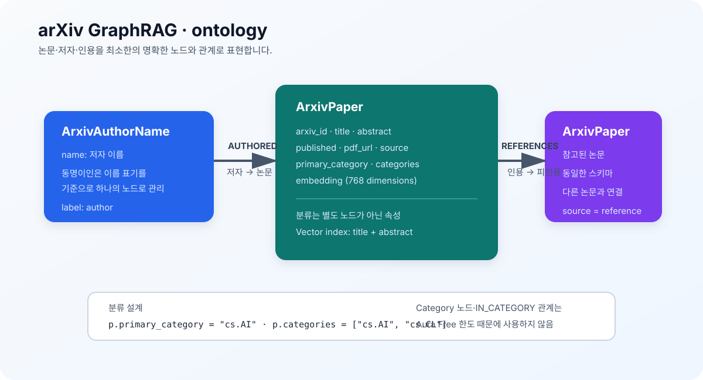
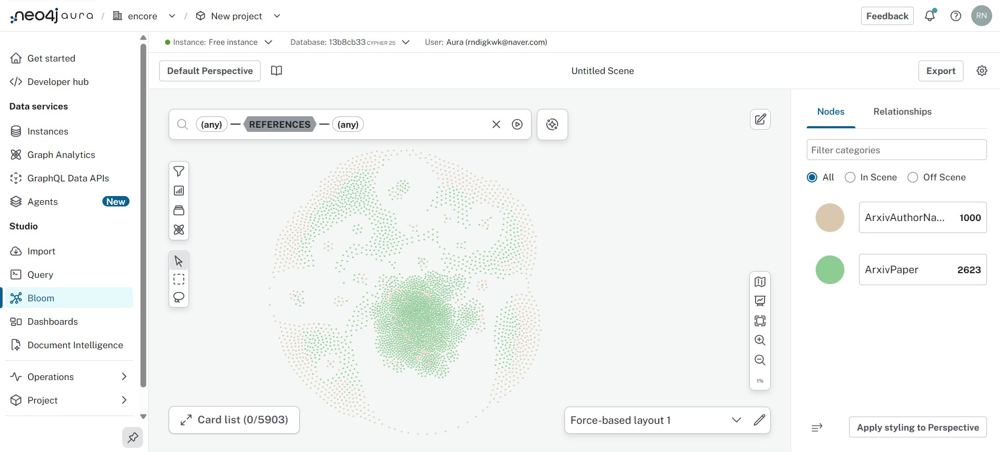
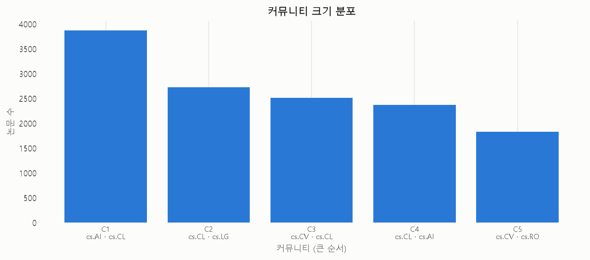
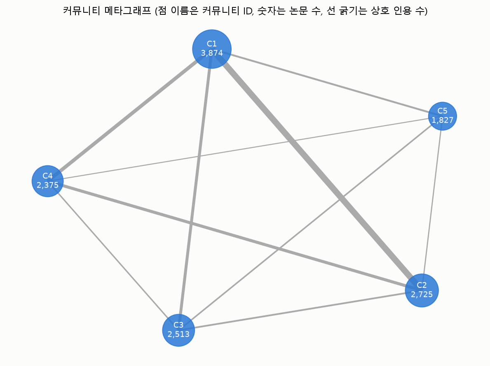

# 데이터 · 온톨로지 · 그래프 분석 · 파이프라인

README에서 옮긴 긴 설명입니다. 요약은 [README](../README.md)에 있습니다.

## Data

`old` 폴더는 제외하고 현재 프로젝트의 JSONL과 노트북을 기준으로 설명합니다.

| 데이터 | 경로 | 내용 |
| --- | --- | --- |
| AI 논문 | `data/ai/arxiv_cs_recent_3months_oai_part1~2.jsonl` | 최근 3개월 AI 논문 **6,467건**. 제목, abstract, 저자, 분류, 발행일, DOI, PDF URL 포함 |
| 인용 원천 | `data/citations_ai/arxiv_citations_part1~2.jsonl` | AI 논문별 Semantic Scholar 인용·참고문헌 메타데이터 |
| 참고문헌 논문 | `data/ai_references/arxiv_ai_references_api/arxiv_ai_references_api_part1~7.jsonl` | AI 논문이 인용한 논문 메타데이터 **31,913행** 및 `cit_arxiv_id` 목록 |

동일한 arXiv ID는 하나의 논문으로 통합합니다. 첫 적재 결과는 논문 **37,854개**, 저자 이름 **111,171개**, `AUTHORED` **268,928개**, `REFERENCES` **69,438개**입니다.
그 뒤 주간 수집으로 2026-11-10 VM 그래프는 논문 **43,728개**, 저자 이름 **123,402개**, `AUTHORED` **304,479개**, `REFERENCES` **148,051개**입니다
(Streamlit 백업 판의 Aura는 2026-10-27 그래프에 고정돼 있습니다).

### GPU 노트북 — 배지를 누르면 Colab에서 바로 열립니다

**런타임 > 런타임 유형 변경**에서 GPU를 고르고 위에서 아래로 실행하면 됩니다. 고칠 셀은
각 노트북의 **1절 하나**입니다.

| | 무엇 |
|---|---|
| [](https://colab.research.google.com/github/rndigkwk/arxiv_graph_RAG/blob/main/notebooks/rerank_finetune_colab.ipynb) [`rerank_finetune_colab.ipynb`](../notebooks/rerank_finetune_colab.ipynb) | 재정렬기를 공동인용으로 미세조정합니다. **바가 노트북에 적혀 있습니다**(ADR-057) — 결과를 보고 움직일 수 없게 |
| [](https://colab.research.google.com/github/rndigkwk/arxiv_graph_RAG/blob/main/notebooks/rerank_pairs_colab.ipynb) [`rerank_pairs_colab.ipynb`](../notebooks/rerank_pairs_colab.ipynb) | 사전학습 교차 인코더로 후보를 재정렬해 채점합니다(ADR-050·051) |
| [](https://colab.research.google.com/github/rndigkwk/arxiv_graph_RAG/blob/main/notebooks/encode_corpus_colab.ipynb) [`encode_corpus_colab.ipynb`](../notebooks/encode_corpus_colab.ipynb) | 로컬 인코더로 말뭉치를 임베딩합니다(ADR-039·046·049) |
| [](https://colab.research.google.com/github/rndigkwk/arxiv_graph_RAG/blob/main/notebooks/finetune_embedding_colab.ipynb) [`finetune_embedding_colab.ipynb`](../notebooks/finetune_embedding_colab.ipynb) | 임베딩 어댑터를 미세조정합니다(ADR-013) |

노트북이 지키는 것이 셋입니다(`tests/test_colab_notebooks.py`가 고정합니다).

- **출력 없이 커밋됩니다.** 커밋된 노트북은 실행 전 상태여야 diff가 읽힙니다.
- **코드 셀이 전부 컴파일됩니다.** 구문 오류를 올리면 사용자가 GPU를 띄운 뒤에 압니다.
- **`files.download()`를 쓰지 않습니다.** VS Code↔Colab 세션에서 **예외 없이 아무 일도
  하지 않습니다**(2026-10-20에 겪었습니다). 가져가기는 허깅페이스를 거칩니다.

### 실행 노트북 파일

- [`arxiv_computer_science_recent_3months_to_jsonl_oai_pmh.ipynb`](../notebooks/arxiv_computer_science_recent_3months_to_jsonl_oai_pmh.ipynb) — arXiv OAI-PMH에서 CS 메타데이터를 수집하고 `published`, `primary_category`로 필터링
- [`arxiv_citations_semantic_scholar_to_jsonl.ipynb`](../notebooks/arxiv_citations_semantic_scholar_to_jsonl.ipynb) — Semantic Scholar Graph API를 배치 조회해 피인용·참고문헌 목록과 인용 지표를 `data/citations_ai`에 저장
- [`arxiv_citation_references_arxiv_api_to_jsonl.ipynb`](../notebooks/arxiv_citation_references_arxiv_api_to_jsonl.ipynb) — 참고문헌 arXiv ID의 메타데이터를 5,000행 단위 JSONL로 수집하고 캐시·상태 파일으로 재개
- [`arxiv_ai_kg_to_aura.ipynb`](../notebooks/arxiv_ai_kg_to_aura.ipynb) — JSONL 정규화, Aura 적재, 제목+abstract 임베딩, 벡터 인덱스 생성

## Ontology



```text
(:ArxivAuthorName {name})-[:AUTHORED]->(:ArxivPaper)
(:ArxivPaper)-[:REFERENCES]->(:ArxivPaper)
```

| 요소 | 설계 |
| --- | --- |
| `ArxivPaper` | `arxiv_id`, `title`, `abstract`, `published`, `pdf_url`, `primary_category`, `categories`, `source`, `embedding` |
| `ArxivAuthorName` | 저자 이름 `name`을 식별하는 노드 |
| `AUTHORED` | 저자에서 논문으로 향하는 저술 관계 |
| `REFERENCES` | 인용 논문에서 피인용 논문으로 향하는 관계 |
| 분류 | `primary_category`, `categories` 속성으로 저장 |

Aura Free의 관계 한도와 고차수 허브 문제를 고려해 `Category` 라벨과 `IN_CATEGORY` 관계는 만들지 않았습니다. `arxiv_id`는 URL·`arXiv:` 접두어·버전 접미어를 제거해 정규화하며, 임베딩 입력은 `title + abstract`입니다.

## Knowledge graph



## Quality report

품질 리포트 노트북은 그래프와 원천 JSONL을 대조해 준수율·정밀도·ER 일관성을 검사하고, GDS로 PageRank와 Leiden 커뮤니티를 분석합니다.

- 분석 노트북: [`aura_graph_rag_quality_report.ipynb`](../notebooks/aura_graph_rag_quality_report.ipynb)
- 결과 JSON: [`aura_graph_rag_quality_report.json`](../reports/aura_graph_rag_quality_report.json)

| 지표 | 결과 |
| --- | --- |
| 스키마 준수율 | 노드·`AUTHORED`·`REFERENCES` 모두 **100%** |
| 정밀도 | 고정 시드 42, 표본 50건의 6개 사실 모두 **100%** |
| ER 일관성 | 중복 ID·필수값 누락·고아 논문·타입 오류·자기참조 **0건** |

## Community analysis

품질 리포트 노트북은 `REFERENCES` 인용망을 기반으로 Leiden 커뮤니티 탐지를 수행합니다. AuraDB Free에는 GDS가 내장되어 있지 않으므로 임시 Aura Graph Analytics 세션에서 계산하며, 원본 AuraDB에는 분석 결과를 쓰지 않습니다. 세션 설정은 2GB 메모리, TTL 30분입니다.

Leiden 분석에서는 방향성이 있는 `REFERENCES` 관계를 커뮤니티 탐지에 사용할 수 있도록 무방향 투영으로 바꿉니다. 따라서 같은 커뮤니티로 묶였다는 것은 두 논문이 같은 분류라는 뜻이 아니라, 인용망에서 서로 연결된 구조적 군집에 속한다는 의미입니다. `randomSeed=42`와 고정 레이아웃을 사용해 결과와 시각화를 재현할 수 있으며, 커뮤니티 번호 자체에는 의미가 없습니다.

리포트는 규모가 큰 상위 5개 커뮤니티의 논문 수와 최빈 `primary_category` 조합을 집계합니다.

| 커뮤니티 | 논문 수 | 대표 분류 조합 |
| --- | ---: | --- |
| C1 | 3,874 | `cs.AI` · `cs.CL` |
| C2 | 2,725 | `cs.CL` · `cs.LG` |
| C3 | 2,513 | `cs.CV` · `cs.CL` |
| C4 | 2,375 | `cs.CL` · `cs.AI` |
| C5 | 1,827 | `cs.CV` · `cs.RO` |

### 커뮤니티 크기 분포

커뮤니티별 논문 수를 큰 순서로 비교해 특정 군집에 논문이 얼마나 집중되는지 보여 줍니다. 막대의 분류 라벨은 해당 커뮤니티에서 가장 많이 나타난 주분류를 나타냅니다.



### 커뮤니티 메타그래프

각 점은 하나의 커뮤니티이며 점의 크기와 점 안 숫자는 커뮤니티의 논문 수를 뜻합니다. 선의 굵기는 두 커뮤니티 사이의 상호 `REFERENCES` 인용 흐름을 나타내므로, 인용 교류가 많은 군집과 군집 간 연결을 한눈에 확인할 수 있습니다.



## Aura 용량 (Aura Free 시절)

- (Aura Free 시절의 계산입니다. 지금 VM에는 그 한도가 없고, 백업 판의 Aura만 해당합니다.) 그 다음 달을 넣을 자리는 **세어 두었습니다** — 관계가 먼저 차고, 적재가 멈추는 선(95%)
  안에서 **3.4개월**(가장 생산량이 많았던 달의 속도로는 2.0개월)이 남아 있어 **아무것도
  지우지 않고** 들어갑니다. 지울 후보는 수확과 함께 **무엇을 깨뜨리는지**까지 쟀고, 네 번째
  달이 필요해지면 먼저 재야 하는 것도 적었습니다
  ([ADR-045](adr/ADR-045-what-to-delete-before-adding-a-month.md)).
- 다만 **자리가 있다고 바로 넣을 수는 없습니다.** 증분 적재문이 `embedding`을 쓰지 않아서,
  그대로 넣으면 새 논문이 그래프 질의에는 나오고 **벡터 검색에는 안 나옵니다.** 스냅샷
  게이트가 커버리지 100%를 요구하지만 그것은 적재 뒤에 걸리므로, 같은 검사를 적재 전에
  한 번 더 두어 막았습니다
  ([ADR-047](adr/ADR-047-the-loader-refuses-papers-the-vector-index-cannot-see.md)).

## Data pipeline and models

데이터는 버전이 박힌 스냅샷으로 고정하고, 학습과 평가는 살아 있는 DB가 아니라 그 스냅샷만
읽습니다. 인용 보강이 과거 논문 쌍에도 간선을 역채움하므로, 라이브 DB에 학습하면 시간 분할이
조용히 무너집니다([`ROADMAP.md` 9절](../ROADMAP.md#9-개선안-ab를-동시에-적용할-때의-충돌)).

```bash
# 내보내기를 버전 스냅샷으로 등록하고 품질 게이트 10개를 돌립니다
uv run python -m pipeline.build_snapshot

# 파생 캐시(메타데이터·임베딩 행렬)를 만듭니다
uv run python -m pipeline.features

# Aura에 남은 자리와 지울 후보 — 수확과 "깨뜨리는 것"을 함께 셉니다 (DB에 붙지 않습니다)
uv run python -m pipeline.capacity

# 증분 수집 시험 실행 — --load 없이는 그래프에 쓰지 않습니다
uv run python -m pipeline.ingest --days 7

# 성공한 창을 다시 받게 워터마크만 되감습니다. 지우지는 못합니다 (ADR-074)
uv run python -m pipeline.ingest --rewind-to 2026-10-20 --reason "보강이 빈 창을 다시 받습니다"

# 공동인용 링크 예측 기준선 사다리
uv run --extra ml python -m models.link_prediction.train

# 피처 절제 + cold-start (스냅샷만 읽으므로 API 비용 없음)
uv run --extra ml python -m models.link_prediction.ablation

# 인용 쌍으로 임베딩 어댑터 학습 (닫힌 해, GPU 불필요)
uv run python -m models.embedding_tuning.train

# 로컬 임베딩 모델과 비교. 첫 실행은 CPU 인코딩에 모델당 3시간 25분 걸립니다
uv run --with sentence-transformers python -m models.embedding_tuning.compare_models   --model sentence-transformers/allenai-specter

# Colab T4에서 파인튜닝하려면 17.6MB 산출물을 내보냅니다 (GPU가 없는 PC에서)
uv run python -m models.embedding_tuning.export_for_colab
```

내보낸 산출물은 Hugging Face 비공개 dataset repo로 올립니다. `huggingface_hub` 2.x의 실행 파일
이름은 `hf`입니다(`huggingface-cli`는 없습니다).

```bash
uv tool install huggingface_hub
hf auth login
hf upload <사용자>/arxiv-graphrag-colab exports/colab exports/colab --repo-type dataset --private
```

파인튜닝 노트북은 [`notebooks/finetune_embedding_colab.ipynb`](../notebooks/finetune_embedding_colab.ipynb)
입니다. `SMOKE = True`로 먼저 돌려 코드가 도는지 확인하고 본 실행을 하세요.

